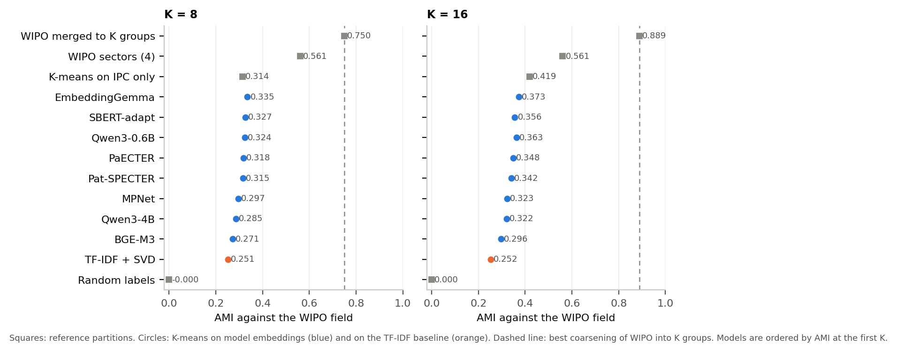
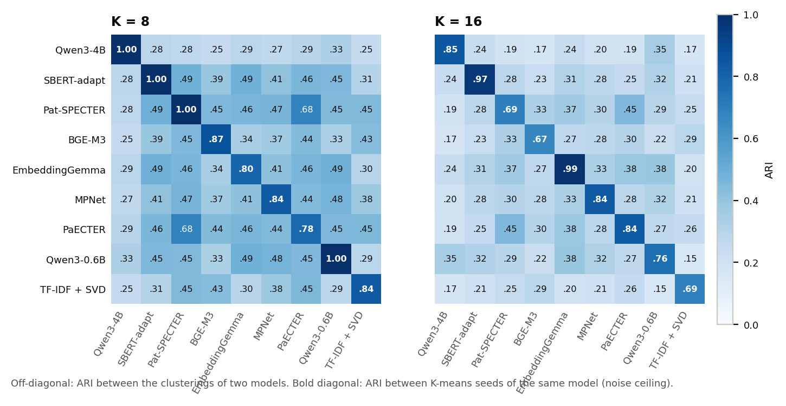
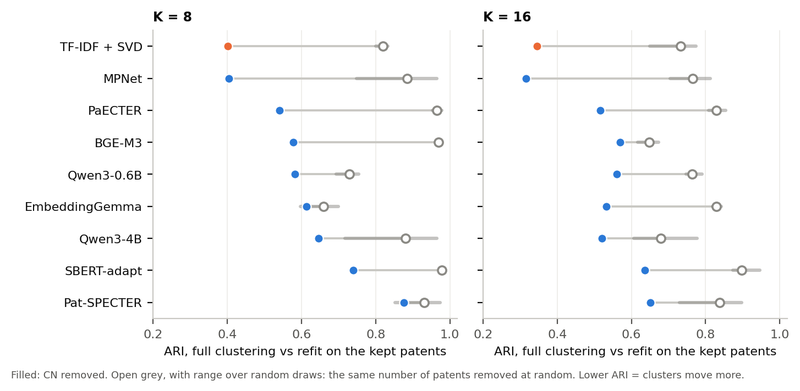
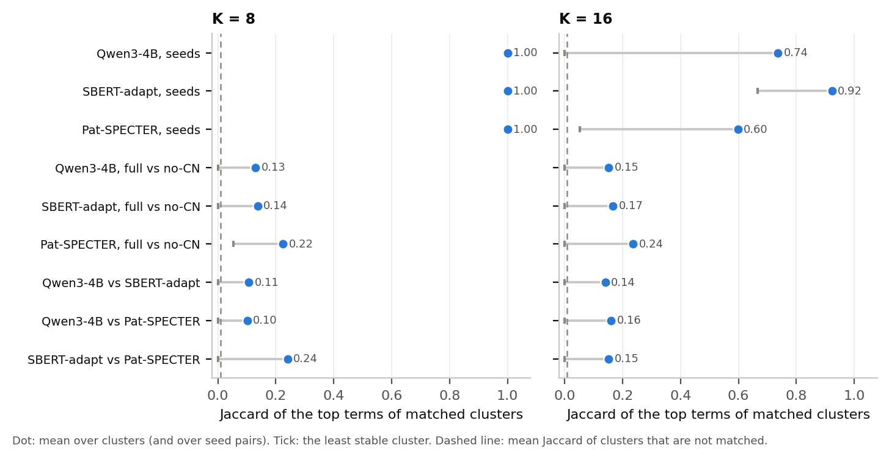

# Results pack

Run: `paper-2026-11`. Created 2026-11-23. numpy 2.2.6, pandas 2.3.3, scikit-learn 1.7.2.
Models: qwen3-embedding-4b, sbert-adapt-ub, pat-specter, bge-m3, qwen3-embedding-0.6b, embeddinggemma-300m, paecter, mpnet, tfidf-svd256.
K: [8, 16]. Seeds: [42, 43, 44]. Cohorts: ['full', 'exclude-cn'].

Level is a proposal: workshop = short paper, journal = extended version.

| Id | Result | Level | Status |
|---|---|---|---|
| R01 | Models and corpus | workshop | done |
| R02 | Reference scale for the AMI against WIPO | workshop | done |
| R03 | Cross-model agreement and noise ceiling | workshop | done |
| R04 | CN as a confounder, removal test | workshop | done |
| R05 | AMI against WIPO inside each office | workshop | done |
| R06 | Stability of the cluster explanations | workshop | done |
| R07 | Manual review of the clusters | workshop | done |
| R08 | Surrogate fidelity of the explanations | journal | todo |
| R09 | Boundary ambiguity | journal | todo |
| R10 | Instruction-prefix ablation for Qwen3-4B | journal | todo |
| R11 | Hand-labelled sample and injected-defect validation | journal | todo |

## R01 Models and corpus

Level: workshop. Status: done.

Question: How do the nine representations (8 embedding models and the TF-IDF baseline) score on the standard metrics?

Message: AMI against WIPO is 0.25-0.34 at K=8 for all models; the TF-IDF baseline is 0.25. Models differ more on AMI against office (0.03-0.17) and on seed stability than on WIPO.

Script: `steps/step2_cluster.py (analysis/run_analysis.py), steps/step4_report.py`

Table `tab_models_full_k8` (files: `tables/tab_models_full_k8.tex`, `tables/tab_models_full_k8.csv`)

| Model | AMI WIPO | AMI office | Silhouette | Seed ARI | ARI full vs no-CN |
|---|---|---|---|---|---|
| qwen3-embedding-4b | 0.285 | 0.164 | 0.132 | 0.999 | 0.646 |
| sbert-adapt-ub | 0.327 | 0.034 | 0.257 | 0.997 | 0.740 |
| pat-specter | 0.315 | 0.043 | 0.147 | 0.997 | 0.876 |
| bge-m3 | 0.273 | 0.076 | 0.058 | 0.867 | 0.578 |
| qwen3-embedding-0.6b | 0.324 | 0.038 | 0.086 | 0.998 | 0.582 |
| embeddinggemma-300m | 0.333 | 0.043 | 0.079 | 0.795 | 0.613 |
| paecter | 0.316 | 0.057 | 0.088 | 0.779 | 0.540 |
| mpnet | 0.298 | 0.079 | 0.060 | 0.836 | 0.404 |
| tfidf-svd256 | 0.253 | 0.166 | 0.072 | 0.836 | 0.402 |

Table `tab_models_full_k16` (files: `tables/tab_models_full_k16.tex`, `tables/tab_models_full_k16.csv`)

| Model | AMI WIPO | AMI office | Silhouette | Seed ARI | ARI full vs no-CN |
|---|---|---|---|---|---|
| qwen3-embedding-4b | 0.318 | 0.133 | 0.142 | 0.848 | 0.520 |
| sbert-adapt-ub | 0.356 | 0.030 | 0.245 | 0.966 | 0.636 |
| pat-specter | 0.342 | 0.041 | 0.124 | 0.694 | 0.651 |
| bge-m3 | 0.299 | 0.077 | 0.040 | 0.671 | 0.569 |
| qwen3-embedding-0.6b | 0.361 | 0.036 | 0.093 | 0.760 | 0.561 |
| embeddinggemma-300m | 0.373 | 0.043 | 0.093 | 0.988 | 0.533 |
| paecter | 0.347 | 0.063 | 0.074 | 0.835 | 0.515 |
| mpnet | 0.321 | 0.074 | 0.058 | 0.841 | 0.315 |
| tfidf-svd256 | 0.246 | 0.180 | 0.062 | 0.688 | 0.346 |

## R02 Reference scale for the AMI against WIPO

Level: workshop. Status: done.

Question: What AMI against WIPO can a partition reach, and where do the models sit?

Message: At K=8 the best coarsening of WIPO reaches 0.750, IPC-only K-means 0.314, the models 0.27-0.34 (36-45% of the ceiling), TF-IDF 0.251. At K=16 IPC-only K-means (0.419) is above every model (max 0.373). WIPO is built from IPC, so this reference is partly circular.

Script: `controls/c01_reference_scale.py`

Figure `fig_reference_scale` (files: `figures/fig_reference_scale.pdf`, `figures/fig_reference_scale.png`)

Table `tab_reference_scale` (files: `tables/tab_reference_scale.tex`, `tables/tab_reference_scale.csv`)

| k | partition | AMI_selection | AMI_office | share_of_merge_oracle |
|---|---|---|---|---|
| 8 | random | -0.000 | -0.000 | -0.000 |
| 8 | sector-oracle | 0.561 | 0.017 | 0.748 |
| 8 | merge-oracle | 0.750 | 0.009 | 1.000 |
| 8 | ipc-kmeans | 0.314 | 0.026 | 0.418 |
| 8 | bge-m3 | 0.271 | 0.077 | 0.362 |
| 8 | embeddinggemma-300m | 0.335 | 0.043 | 0.447 |
| 8 | mpnet | 0.297 | 0.081 | 0.396 |
| 8 | paecter | 0.318 | 0.056 | 0.424 |
| 8 | pat-specter | 0.315 | 0.043 | 0.421 |
| 8 | qwen3-embedding-0.6b | 0.324 | 0.038 | 0.433 |
| 8 | qwen3-embedding-4b | 0.285 | 0.164 | 0.380 |
| 8 | sbert-adapt-ub | 0.327 | 0.034 | 0.436 |
| 8 | tfidf-svd256 | 0.251 | 0.170 | 0.335 |
| 16 | random | 0.000 | 0.000 | 0.000 |
| 16 | sector-oracle | 0.561 | 0.017 | 0.631 |
| 16 | merge-oracle | 0.889 | 0.015 | 1.000 |
| 16 | ipc-kmeans | 0.419 | 0.026 | 0.471 |
| 16 | bge-m3 | 0.296 | 0.075 | 0.333 |
| 16 | embeddinggemma-300m | 0.373 | 0.043 | 0.420 |
| 16 | mpnet | 0.323 | 0.074 | 0.363 |
| 16 | paecter | 0.348 | 0.061 | 0.392 |
| 16 | pat-specter | 0.342 | 0.041 | 0.385 |
| 16 | qwen3-embedding-0.6b | 0.363 | 0.036 | 0.408 |
| 16 | qwen3-embedding-4b | 0.322 | 0.127 | 0.362 |
| 16 | sbert-adapt-ub | 0.356 | 0.030 | 0.401 |
| 16 | tfidf-svd256 | 0.252 | 0.168 | 0.284 |

## R03 Cross-model agreement and noise ceiling

Level: workshop. Status: done.

Question: How much do models agree, compared with the agreement of K-means with itself across seeds?

Message: Qwen3-4B is the outlier (mean ARI with the others 0.28 at K=8, 0.22 at K=16). Pat-SPECTER and PaECTER are the closest pair (0.68). Several models are not stable across seeds at K=8 (gemma 0.80, PaECTER 0.78, mpnet 0.84, TF-IDF 0.84), which limits agreement.

Script: `controls/c02_noise_ceiling.py`

Figure `fig_cross_model` (files: `figures/fig_cross_model.pdf`, `figures/fig_cross_model.png`)

Table `tab_cross_model` (files: `tables/tab_cross_model.tex`, `tables/tab_cross_model.csv`)

| k | model | seed_ari | mean_ari_vs_others | max_ari | closest_model |
|---|---|---|---|---|---|
| 8 | qwen3-embedding-4b | 0.999 | 0.280 | 0.326 | qwen3-embedding-0.6b |
| 8 | sbert-adapt-ub | 0.997 | 0.409 | 0.488 | pat-specter |
| 8 | pat-specter | 0.997 | 0.465 | 0.680 | paecter |
| 8 | bge-m3 | 0.867 | 0.374 | 0.451 | pat-specter |
| 8 | qwen3-embedding-0.6b | 0.998 | 0.407 | 0.487 | embeddinggemma-300m |
| 8 | embeddinggemma-300m | 0.795 | 0.404 | 0.487 | qwen3-embedding-0.6b |
| 8 | paecter | 0.779 | 0.460 | 0.680 | pat-specter |
| 8 | mpnet | 0.836 | 0.403 | 0.475 | qwen3-embedding-0.6b |
| 8 | tfidf-svd256 | 0.836 | 0.357 | 0.454 | paecter |
| 16 | qwen3-embedding-4b | 0.848 | 0.219 | 0.348 | qwen3-embedding-0.6b |
| 16 | sbert-adapt-ub | 0.966 | 0.265 | 0.320 | qwen3-embedding-0.6b |
| 16 | pat-specter | 0.694 | 0.307 | 0.452 | paecter |
| 16 | bge-m3 | 0.671 | 0.261 | 0.326 | pat-specter |
| 16 | qwen3-embedding-0.6b | 0.760 | 0.290 | 0.385 | embeddinggemma-300m |
| 16 | embeddinggemma-300m | 0.988 | 0.310 | 0.385 | qwen3-embedding-0.6b |
| 16 | paecter | 0.835 | 0.298 | 0.452 | pat-specter |
| 16 | mpnet | 0.841 | 0.276 | 0.335 | embeddinggemma-300m |
| 16 | tfidf-svd256 | 0.688 | 0.215 | 0.285 | bge-m3 |

## R04 CN as a confounder, removal test

Level: workshop. Status: done.

Question: Does removing CN move the clusters more than removing the same number of patents at random?

Message: Yes for all models. ARI between full clustering and refit at K=8: remove-CN 0.40-0.88, remove-random 0.66-0.98 (Qwen3-4B 0.65 vs 0.88, SBERT 0.74 vs 0.98, Pat-SPECTER 0.88 vs 0.93). The AMI against WIPO on the same patents changes little after refit, so the higher AMI seen when CN is excluded comes mostly from which patents are scored.

Script: `controls/c03_confounder_cn.py`

Figure `fig_cn_removal` (files: `figures/fig_cn_removal.pdf`, `figures/fig_cn_removal.png`)

Table `tab_confounder_cn` (files: `tables/tab_confounder_cn.tex`, `tables/tab_confounder_cn.csv`)

| model | k | ARI_full_vs_refit_remove-CN | ARI_full_vs_refit_remove-random | AMI_change_remove-CN | AMI_change_remove-random |
|---|---|---|---|---|---|
| qwen3-embedding-4b | 8 | 0.646 | 0.880 | 0.032 | -0.002 |
| qwen3-embedding-4b | 16 | 0.520 | 0.679 | 0.018 | -0.003 |
| sbert-adapt-ub | 8 | 0.740 | 0.978 | -0.001 | 0.000 |
| sbert-adapt-ub | 16 | 0.636 | 0.897 | 0.013 | -0.000 |
| pat-specter | 8 | 0.876 | 0.931 | 0.001 | 0.001 |
| pat-specter | 16 | 0.651 | 0.837 | 0.005 | -0.001 |
| bge-m3 | 8 | 0.578 | 0.969 | 0.010 | -0.000 |
| bge-m3 | 16 | 0.569 | 0.648 | 0.012 | 0.004 |
| qwen3-embedding-0.6b | 16 | 0.561 | 0.763 | 0.001 | 0.002 |
| qwen3-embedding-0.6b | 8 | 0.582 | 0.729 | 0.010 | 0.012 |
| embeddinggemma-300m | 16 | 0.533 | 0.829 | -0.014 | 0.002 |
| embeddinggemma-300m | 8 | 0.613 | 0.659 | 0.003 | -0.007 |
| paecter | 8 | 0.540 | 0.965 | 0.002 | -0.000 |
| paecter | 16 | 0.515 | 0.829 | -0.000 | -0.005 |
| mpnet | 8 | 0.404 | 0.885 | 0.003 | 0.000 |
| mpnet | 16 | 0.315 | 0.766 | 0.068 | 0.004 |
| tfidf-svd256 | 8 | 0.402 | 0.820 | -0.009 | -0.001 |
| tfidf-svd256 | 16 | 0.346 | 0.732 | -0.019 | -0.002 |

## R05 AMI against WIPO inside each office

Level: workshop. Status: done.

Question: Does the alignment with WIPO survive inside each office?

Message: Yes: 0.25-0.39 inside every office group. CN is the lowest for all models; the gap to the other offices is largest for Qwen3-4B (0.26 vs about 0.35).

Script: `controls/c03_confounder_cn.py`

Table `tab_within_office` (files: `tables/tab_within_office.tex`, `tables/tab_within_office.csv`)

| model | CN | EP | JP | KR | Other | US | WO |
|---|---|---|---|---|---|---|---|
| qwen3-embedding-4b | 0.261 | 0.364 | 0.347 | 0.317 | 0.348 | 0.353 | 0.363 |
| sbert-adapt-ub | 0.311 | 0.367 | 0.347 | 0.324 | 0.356 | 0.358 | 0.349 |
| pat-specter | 0.294 | 0.365 | 0.347 | 0.325 | 0.356 | 0.354 | 0.352 |
| bge-m3 | 0.252 | 0.318 | 0.303 | 0.288 | 0.313 | 0.303 | 0.318 |
| qwen3-embedding-0.6b | 0.302 | 0.394 | 0.343 | 0.331 | 0.364 | 0.365 | 0.375 |
| embeddinggemma-300m | 0.319 | 0.368 | 0.351 | 0.337 | 0.358 | 0.361 | 0.369 |
| paecter | 0.298 | 0.355 | 0.341 | 0.337 | 0.364 | 0.351 | 0.351 |
| mpnet | 0.288 | 0.330 | 0.311 | 0.301 | 0.328 | 0.300 | 0.325 |
| tfidf-svd256 | 0.249 | 0.279 | 0.261 | 0.237 | 0.268 | 0.260 | 0.269 |

## R06 Stability of the cluster explanations

Level: workshop. Status: done.

Question: Do the c-TF-IDF cluster cards stay the same across seeds, cohorts and models?

Message: Across seeds the cards are as stable as the clustering: at K=8 identical (Jaccard 1.0); at K=16 SBERT 0.89-0.96 (seed ARI 0.97), Qwen3-4B 0.63-0.85 (0.85), Pat-SPECTER 0.48-0.72 (0.69), with the minimum over clusters down to 0-0.18 for the last two. Across cohorts (full vs exclude-CN) the term Jaccard is 0.13-0.24 at both K, minimum 0, even when 94% of the patents are kept (Pat-SPECTER, K=8). Across models 0.10-0.24, against 0.003-0.015 for unmatched clusters. The Jaccard on the top 10 terms is strict; a comparison of the labels would complement it.

Script: `controls/c04_explanation_stability.py`

Figure `fig_explanation_stability` (files: `figures/fig_explanation_stability.pdf`, `figures/fig_explanation_stability.png`)

Table `tab_explanation_stability` (files: `tables/tab_explanation_stability.tex`, `tables/tab_explanation_stability.csv`)

| comparison | model_a | model_b | k | detail | mean_overlap_share | mean_jaccard_matched | min_jaccard_matched | mean_jaccard_unmatched |
|---|---|---|---|---|---|---|---|---|
| seed | qwen3-embedding-4b | qwen3-embedding-4b | 8 | seed 42 vs 43 | 1.000 | 1.000 | 1.000 | 0.018 |
| seed | qwen3-embedding-4b | qwen3-embedding-4b | 8 | seed 42 vs 44 | 0.999 | 1.000 | 1.000 | 0.018 |
| cohort | qwen3-embedding-4b | qwen3-embedding-4b | 8 | full vs exclude-cn | 0.571 | 0.129 | 0.000 | 0.014 |
| seed | sbert-adapt-ub | sbert-adapt-ub | 8 | seed 42 vs 43 | 1.000 | 1.000 | 1.000 | 0.006 |
| seed | sbert-adapt-ub | sbert-adapt-ub | 8 | seed 42 vs 44 | 0.998 | 1.000 | 1.000 | 0.006 |
| cohort | sbert-adapt-ub | sbert-adapt-ub | 8 | full vs exclude-cn | 0.740 | 0.138 | 0.000 | 0.003 |
| seed | pat-specter | pat-specter | 8 | seed 42 vs 43 | 0.998 | 1.000 | 1.000 | 0.004 |
| seed | pat-specter | pat-specter | 8 | seed 42 vs 44 | 0.999 | 1.000 | 1.000 | 0.004 |
| cohort | pat-specter | pat-specter | 8 | full vs exclude-cn | 0.937 | 0.225 | 0.053 | 0.008 |
| model | qwen3-embedding-4b | sbert-adapt-ub | 8 | reference seeds | 0.496 | 0.106 | 0.000 | 0.010 |
| model | qwen3-embedding-4b | pat-specter | 8 | reference seeds | 0.507 | 0.101 | 0.000 | 0.012 |
| model | sbert-adapt-ub | pat-specter | 8 | reference seeds | 0.653 | 0.241 | 0.000 | 0.003 |
| seed | qwen3-embedding-4b | qwen3-embedding-4b | 16 | seed 42 vs 43 | 0.942 | 0.845 | 0.429 | 0.006 |
| seed | qwen3-embedding-4b | qwen3-embedding-4b | 16 | seed 42 vs 44 | 0.853 | 0.627 | 0.000 | 0.006 |
| cohort | qwen3-embedding-4b | qwen3-embedding-4b | 16 | full vs exclude-cn | 0.563 | 0.152 | 0.000 | 0.006 |
| seed | sbert-adapt-ub | sbert-adapt-ub | 16 | seed 42 vs 43 | 0.989 | 0.955 | 0.818 | 0.006 |
| seed | sbert-adapt-ub | sbert-adapt-ub | 16 | seed 42 vs 44 | 0.971 | 0.892 | 0.667 | 0.006 |
| cohort | sbert-adapt-ub | sbert-adapt-ub | 16 | full vs exclude-cn | 0.646 | 0.167 | 0.000 | 0.003 |
| seed | pat-specter | pat-specter | 16 | seed 42 vs 43 | 0.867 | 0.715 | 0.176 | 0.015 |
| seed | pat-specter | pat-specter | 16 | seed 42 vs 44 | 0.804 | 0.482 | 0.053 | 0.009 |
| cohort | pat-specter | pat-specter | 16 | full vs exclude-cn | 0.694 | 0.236 | 0.000 | 0.008 |
| model | qwen3-embedding-4b | sbert-adapt-ub | 16 | reference seeds | 0.396 | 0.140 | 0.000 | 0.011 |
| model | qwen3-embedding-4b | pat-specter | 16 | reference seeds | 0.387 | 0.161 | 0.000 | 0.005 |
| model | sbert-adapt-ub | pat-specter | 16 | reference seeds | 0.410 | 0.152 | 0.000 | 0.006 |

## R07 Manual review of the clusters

Level: workshop. Status: done.

Question: Do the clusters of the three deep-dive models make sense to a reader?

Message: Qwen3-4B and SBERT reviewed at K=8 (Qwen cluster 1 provisional); Pat-SPECTER pending.

Script: `docs/cluster-label-review.md (manual)`

## R08 Surrogate fidelity of the explanations

Level: journal. Status: todo.

Question: How well does a linear TF-IDF surrogate reproduce the cluster assignment, and so how faithful is a term-based card?

Script: `controls/c05_surrogate.py (to write)`

## R09 Boundary ambiguity

Level: journal. Status: todo.

Question: Is the distance margin to the second cluster related to the number of compatible WIPO fields?

Script: `controls/c06_boundary.py (to write; needs the embeddings)`

## R10 Instruction-prefix ablation for Qwen3-4B

Level: journal. Status: todo.

Question: How much of the Qwen3-4B behaviour (outlier, office sensitivity) comes from the clustering instruction?

Script: `controls/c07_prefix_ablation.py (to write; needs GPU, about 17 minutes on an A100)`

## R11 Hand-labelled sample and injected-defect validation

Level: journal. Status: todo.

Question: Do the controls flag known defects, and do they agree with human judgement? Small labelled sample, two annotators.

Script: `to be designed`
